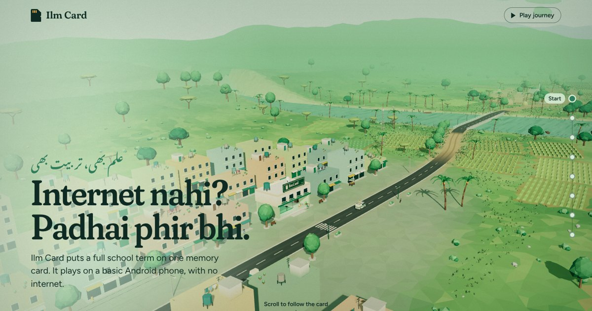

# Ilm Card · علم بھی، تربیت بھی

**🏆 1st Place, AICON'26 Pitch Fest (NUST)**

Ilm Card is an offline-learning startup that puts a full school term on one memory card. The card plays on a basic Android phone with no internet. This repo is the startup's website. It tells the story as a scroll-driven 3D journey from our studio in Multan to a village classroom after dark.

🔗 **Live:** [ilmcard.vercel.app](https://ilmcard.vercel.app)

<p align="center"></p>

## The idea

- **25.37M children** aged 5–16 are out of school in Pakistan, and in rural areas mobile data costs more than most families can spare.
- Teachers record every lecture of the term to the Punjab board syllabus, each with a quiz and homework, and the whole term is copied onto memory cards.
- Families buy the card at the mobile shop where they already buy phone balance, and unlock each month with a scratch voucher and one SMS. It costs **Rs 500/month (about Rs 17 a day)** and needs no bank account and no data.
- Scores come back by SMS. A weekly *tarbiyat* (character) lesson is part of the course.

I led the 3-member team, pitched to the judges, built this site, and as CFO owned the financial plan and the **Rs 7M funding ask**.

## How the site is built

- **No framework and no build step.** It's plain HTML, CSS and JavaScript, so it's fast on low-end phones and cheap networks, like the people it's for.
- **A scroll-driven 3D scene** in [three.js](https://threejs.org) (r149, vendored). Each chapter of the story moves the camera along the route from Multan to the village.
- **Graceful fallback.** Without WebGL, the same story and facts render as a plain, readable page.
- **Self-contained.** Fonts (Fraunces, Figtree and Noto Nastaliq Urdu for the Urdu tagline) and the 3D library are bundled, so the site makes no third-party requests.
- **Ready for link previews**, with Open Graph metadata for WhatsApp and social sharing.

```
index.html        page structure and story copy
css/style.css     styles
js/journey.js     3D scene, scroll choreography and page behaviour
js/config.js      contact details
js/three.min.js   three.js r149 (MIT)
fonts/            self-hosted variable fonts (SIL OFL)
assets/           favicon and share image
```

## Run locally

```bash
python3 -m http.server 8000   # then open http://localhost:8000
```

It's deployed on Vercel as a static site.
